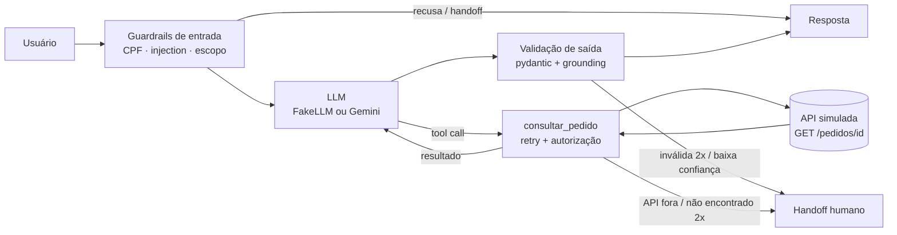

# Arquitetura

## Visão geral

Monolito modular em Python. Um único processo contém o agente; a API de varejo
é um segundo processo (FastAPI) que simula o sistema de pedidos da loja.

## Fluxo de um turno

1. **Mascaramento de CPF** — a mensagem é mascarada antes de qualquer outro
   passo. Daqui em diante só existe o texto mascarado (LLM, histórico e logs).
2. **Detector de prompt injection** — padrões com peso (YAML) sobre o texto
   normalizado. Acima do limiar: recusa, sem chamar o LLM.
3. **Escopo** — só status de pedido. Tema proibido (ex.: jurídico): handoff.
   Sem sinal de escopo: pedido de esclarecimento, sem chamar o LLM.
4. **Loop de tool calling** — o LLM recebe system prompt, histórico e a
   definição da única tool. Se pedir a tool, o código executa
   `consultar_pedido` e devolve o resultado; se responder, segue para o passo 5.
   Há limite de passos.
5. **Tool** — chamada HTTP com timeout e retry com backoff exponencial + jitter.
   A **autorização** (pedido pertence ao cliente da sessão?) é decidida aqui,
   em código; dado de outro cliente nunca chega ao LLM.
6. **Validação de saída** — o JSON final do LLM é validado com pydantic e
   conferido contra o resultado da tool (grounding). Inválido: uma nova
   tentativa; inválido de novo: handoff.
7. **Log** — um registro JSON por turno, sempre mascarado.

## Módulos

| Pasta (`src/agente_varejo/`) | Responsabilidade |
|---|---|
| `config.py` | Localiza a raiz do projeto e carrega os YAML de `config/`. |
| `api_simulada/` | FastAPI com `GET /pedidos/{id}` e os ids que forçam falha. |
| `guardrails/` | CPF, injection, escopo e autorização. Funções puras. |
| `llm/` | Interface `LLMClient`, `FakeLLM` (testes/eval) e adaptador Gemini. |
| `agente/` | Loop de tool calling, tool, retry, sessão, validação e handoff. |
| `logs/` | Log estruturado em JSON com mascaramento na saída. |
| `avaliacao/` | Runner dos casos de `tests/casos/` (`make eval`). |

Domínio fora do código: `config/pedidos.yaml` (dados sintéticos),
`config/guardrails.yaml` (padrões e termos), `config/mensagens.yaml` (textos
fixos de recusa/handoff), `config/agente.yaml` (modelo, limites, retry) e
`prompts/` (system prompt versionado).

## Decisões

Registradas em `docs/adr/`. A central é a
[ADR-0001](adr/0001-guardrails-em-codigo.md): controles de segurança ficam em
código determinístico, não no prompt.
